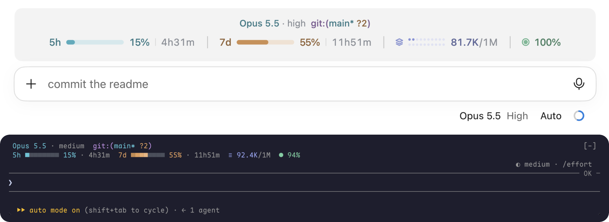
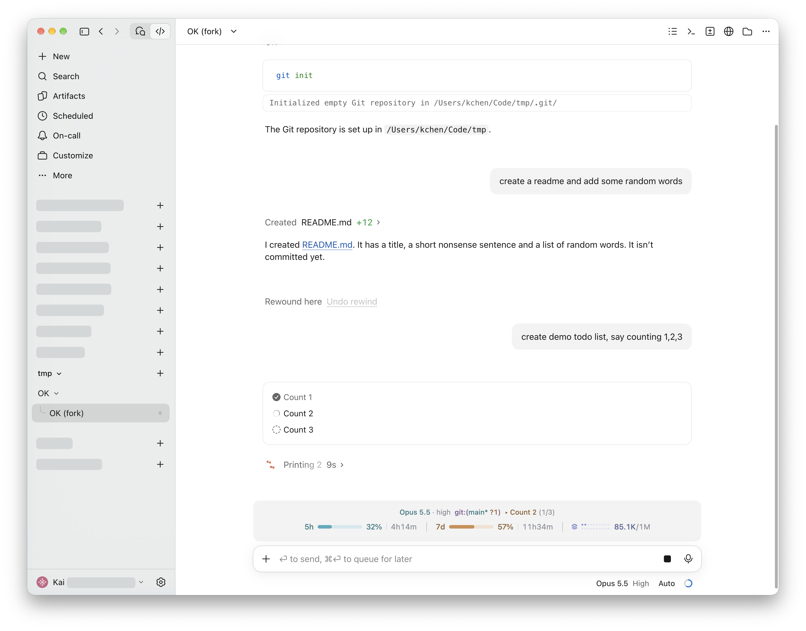
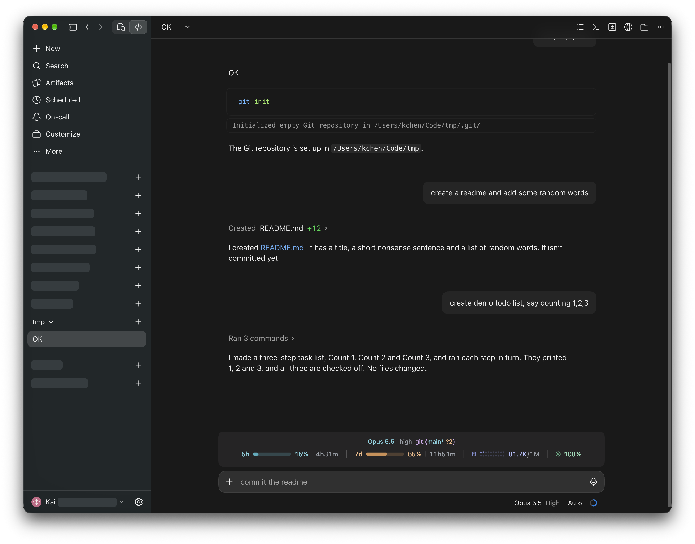
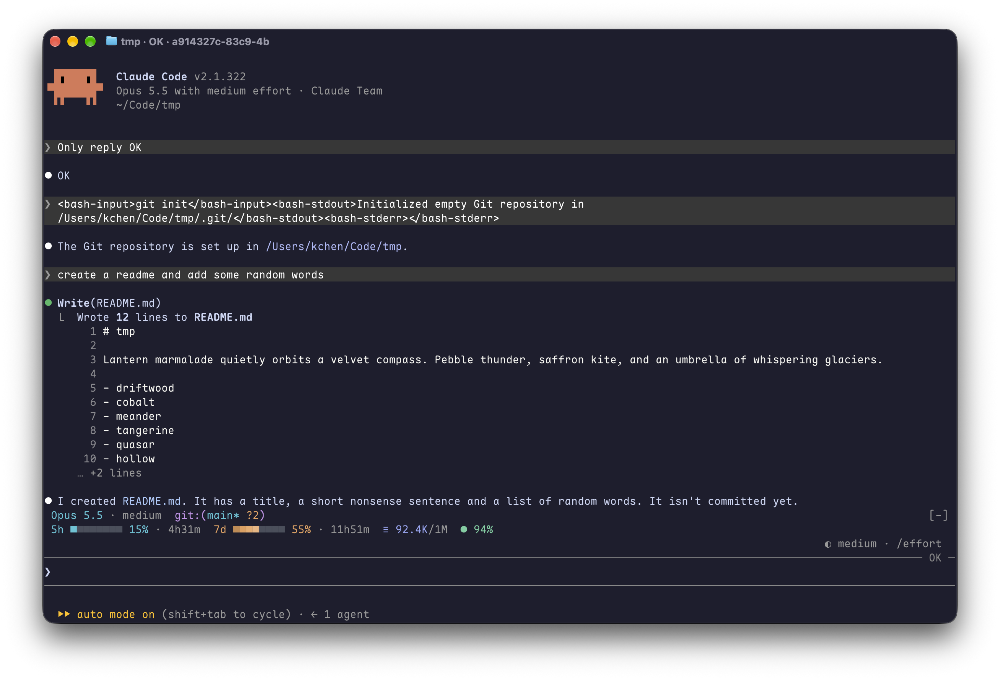

<div align="center">

# CC-Usage-Band-Plus

**Your model, effort, git status and todos, over your Claude Code limits, context and cache: one glance above the prompt.**

[](./LICENSE)
[](https://claude.com/claude-code)
[](https://claude.com/blog/claude-code-mods)


English · [简体中文](./README.zh-CN.md)



</div>

---

`usage-band-plus` is a [Claude Code mod](https://claude.com/blog/claude-code-mods) that draws two rows above the prompt: what the session is doing (model, effort, git status, todo progress) over the four numbers worth watching while you work. It is a fork of [usage-band](https://github.com/JetsonChan/CC-Usage-Band) by Jetson Chan, which draws the second row; this fork adds the first. It has its own layout for the terminal and for the desktop app, updates itself after every turn, and stays out of the way until something needs attention.

> **Fork notice.** usage-band-plus is a fork of [usage-band](https://github.com/JetsonChan/CC-Usage-Band), created by **Jetson Chan**, who wrote the usage row (limits, context window, cache hit rate), the terminal and desktop drawing, and the preview command. This fork, maintained by Kai Chen, adds the info row (model, effort, git status, todos). Both are MIT licensed.

> **Installing with an AI agent?** Have it run the two commands under [Installation](#installation). Agents: once it succeeds, this is all the user needs to hear:
>
> *usage-band-plus is installed. Open a new session (or run `/reload-plugins`) and a band above the prompt shows your model, effort, git status and todos, over your 5h and 7d limits, context window and cache hit rate. Nothing to configure.*

## Contents

- [Features](#features)
- [Requirements](#requirements)
- [Installation](#installation)
- [Configuration](#configuration)
- [What the numbers mean](#what-the-numbers-mean)
- [Terminal compatibility](#terminal-compatibility)
- [Privacy and permissions](#privacy-and-permissions)
- [Development](#development)
- [Screenshots](#screenshots)
- [License](#license)

## Features

| Metric | Shows |
| --- | --- |
| **5h** limit | How much of the rolling 5-hour window you have used, and when it resets |
| **7d** limit | The same for the weekly window |
| **Context window** (layers icon) | Tokens in the context out of the model's window, e.g. `398K/1M` |
| **Cache hit rate** (target icon) | How much of the last turn's input the prompt cache served |
| **Model · effort** | The main loop's model and the reasoning effort its requests go out with, e.g. `Opus 5.5 · high` |
| **Git** | Branch, `*` when the tree is dirty, then counts: `✗` conflicts, `!` modified, `+` staged, `?` untracked, `↑` ahead, `↓` behind, e.g. `git:(main* !2 +1 ?3 ↑1)`. A count of zero is left out. |
| **Todos** | The task in progress and how many are done, e.g. `▸ Fix the bug (2/5)`; `✓ 5/5` once all are done |

- **Glanceable.** Each metric has its own color. It turns red only when it needs you: a limit or the context past 80%, or a cache hit rate under 50%.
- **Alive, not noisy.** A slow shine sweeps across the limit bars, every bar in step.
- **Native on both surfaces.** Terminal: a character line with Nerd Font or Unicode icons that fits itself to the window width. Desktop app: a centered SVG row with bars, a 2×10 dot matrix for the context window, and light and dark mode.
- **Light.** No files read or written, no network. Beyond the figures Claude Code already has, it runs one read-only `git status` in the session's directory.

## Requirements

- Claude Code **2.1.322 or newer** (the release the info row was built and checked against), in the terminal or the desktop app's Code tab
- A Claude subscription for the 5h and 7d figures. Without one, the band shows the context window and cache hit rate only.
- **Recommended terminal: [Ghostty](https://ghostty.org).** It ships the icon font the band uses, so you get the full look with no setup. Other terminals work too, with simpler icons.

## Installation

Run these two commands inside Claude Code:

```
/plugin marketplace add NeoNeuron/cc-usage-band-plus
/plugin install usage-band-plus@cc-usage-band-plus
```

Then **open a new session**. The band appears above the prompt. That's it, nothing to configure.

- Want it in the current session right away? Run `/reload-plugins`.
- The 5h and 7d figures show up after Claude's first reply in the session.
- If you also have the original `usage-band` installed, turn it off (`/plugin`), or both bands draw.

To try it for one session from a local checkout instead:

```bash
git clone https://github.com/NeoNeuron/cc-usage-band-plus.git
claude --plugin-dir cc-usage-band-plus/usage-band-plus
```

**Update**

```
/plugin marketplace update cc-usage-band-plus
```

**Uninstall**

```
/plugin uninstall usage-band-plus@cc-usage-band-plus
```

## Configuration

Nothing to set up. The band picks its terminal icons by itself: Nerd Font icons in Ghostty, plain Unicode elsewhere. The desktop app draws its own icons.

If your terminal shows boxes instead of icons, or you use a Nerd Font in another terminal, set `USAGE_BAND_ICONS` in your shell profile (e.g. `~/.zshrc`) and start a new session:

```bash
export USAGE_BAND_ICONS=unicode   # auto (default) · nerd · unicode · ascii
```

## What the numbers mean

| Metric | Source | Notes |
| --- | --- | --- |
| 5h / 7d | The rate-limit windows Claude Code reads from each API response | Rounded to whole percent. The reset time counts down every minute. |
| Context | The last request's input: uncached + cache reads + cache writes | Against the current model's window, so 1M and 200K models both read right. On desktop each dot is 5% of the window, filling the top row first. |
| Cache hit | Last turn's `cache_read / (input + cache_read + cache_write)` | Summed over every request in the turn. Subagent turns are not counted. |
| Model · effort | The model and effort of the main loop's latest request | Before the first request: `/model`'s value, and the `effortLevel` setting or `CLAUDE_CODE_EFFORT_LEVEL`. Effort is hidden for a model that takes none. |
| Git | `git --no-optional-locks status --porcelain=v2 --branch` in the session's directory | Read at session start, after each turn, after a Bash, Edit, Write or NotebookEdit call, and every minute. Hidden outside a repository. |
| Todos | The results of `TodoWrite`, `TaskCreate` and `TaskUpdate` calls, subagents' included | Built from the calls the mod sees, so tasks made before it loaded appear once they are updated. |

## Terminal compatibility

| Terminal | Icons with `auto` | Colors |
| --- | --- | --- |
| Ghostty | Nerd Font (built in) | Truecolor |
| iTerm2, WezTerm, kitty, Warp | Unicode (`≡` `●`) | Truecolor |
| macOS Terminal | Unicode | 256 colors, mapped automatically |
| Anything else | Unicode | Whatever the terminal reports |

If icons show as boxes, set `USAGE_BAND_ICONS=unicode` (see [Configuration](#configuration)). Run `/usage-band-plus-preview` to compare every style in your own terminal.

## Privacy and permissions

Mods run with the same access as Claude Code itself and are not sandboxed, so here is everything this one touches:

- **Reads** the session's usage figures (`session.measure`, `turn.complete`, `$.session.usage`), its model (`$.session.model`, `turn.step`), the `effortLevel` setting, and the `TERM_PROGRAM`, `USAGE_BAND_ICONS` and `CLAUDE_CODE_EFFORT_LEVEL` environment variables
- **Watches** the results of `TodoWrite`, `TaskCreate` and `TaskUpdate` calls for the todo list, and passes every call through unchanged
- **Runs** one command, `git --no-optional-locks status --porcelain=v2 --branch`, in the session's directory. It is read-only and takes no lock on the repository.
- **Registers** one command, `/usage-band-plus-preview`
- **Draws** the band above the prompt

It does not read or write files, run any other process, call the network or send any data anywhere. The whole mod is one file: [`usage-band-plus/hooks/register.tsx`](./usage-band-plus/hooks/register.tsx).

## Development

```
.
├── .claude-plugin/marketplace.json   # the cc-usage-band-plus marketplace
└── usage-band-plus/
    ├── .claude-plugin/plugin.json    # manifest
    ├── hooks/register.tsx            # the mod
    ├── types/index.d.ts              # state contract
    └── tests/band.test.ts
```

```bash
cd usage-band-plus
claude plugin validate .
claude plugin test .
```

While editing, load it with `claude --plugin-dir ./usage-band-plus`; the session reloads it when a file changes.

Issues and pull requests are welcome.

## Screenshots

These show the usage row as the original usage-band draws it; the info row sits above it.

**Desktop app, light mode**



**Desktop app, dark mode**



**Terminal** (Ghostty). Narrow terminals drop the bars first, then the reset times. Run `/usage-band-plus-preview` to see every terminal style side by side.



## License

[MIT](./LICENSE). The original usage-band is © Jetson Chan; the changes in this fork are by Kai Chen. See the fork notice at the top.
